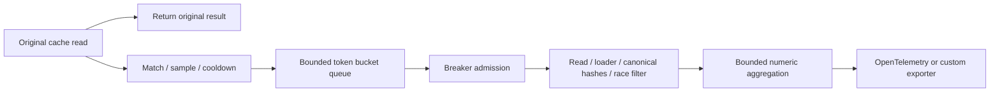

# Architecture

## Decisions fixed before the verifier

1. `wrap(adapter, {rules})` returns a Proxy of `adapter.client`. It intercepts promise-based `get` and `mget`, returns their original results, and binds other methods to the original client. Original read rejections propagate unchanged. Callback overloads bypass auditing. For `mget`, each hit is independently matched and sampled in input order; misses are never audited. First matching rule wins; strings are anchored glob patterns with `*` as the only wildcard, RegExp state is reset on every match. Default metric labels use normalized configured glob templates; exact strings and regexes get numbered labels. Custom normalization is trusted and must never output raw keys. Template normalization can merge semantically different rules.
2. Raw keys and values exist only transiently in queued/active work, as required for loaders and comparisons. Keys in cooldown storage are SHA-256 digests. Audit records and exports contain only capped normalized labels, outcomes, numeric observations and comparison hashes/lengths. Custom normalizers must return static, nonsensitive labels; this is an explicit trust boundary.
3. All equality checks use the same canonical hashes, ignore paths and optional comparator. A comparator returning true means equal. It must be synchronous, pure and fast, and cannot be preempted. Unsupported/circular inputs skip the check; oversized inputs skip before invoking custom code. Comparator exceptions are counted as audit errors. Redis JSON strings are parsed by the adapter, so loaders can return objects.
4. Each loader has a two-second timeout and an AbortSignal. Timeout releases the worker. Independently bounded outstanding-loader slots remain occupied until the underlying promise settles, even when cancellation is ignored. New loaders are refused when these slots are full. This sacrifices availability to bound origin work. JavaScript cannot forcibly terminate arbitrary in-process code. Adapter reads, callbacks and exporters also have bounded waits; unresolved callbacks/exports cannot be repeatedly spawned.
5. Sampling uses SHA-256 of a length-delimited key and time-window number, reduced to 10,000 buckets. Rate zero rejects before hashing. Cooldown hashes are bounded with oldest-entry eviction; this can allow reauditing evicted keys. Sampling agreement is cross-process; cooldown and budgets are per auditor instance.
6. Breaker observations are the last 100 loader calls within 60 seconds, with a default minimum of 10. Nearest-rank p95 is `sorted[ceil(.95*n)-1]`. Strictly exceeding either threshold opens the breaker. After cooldown exactly one verification may probe. All its loader calls must succeed within the latency threshold to close; timeout/error/slow probe reopens. Stale data is not a loader error.
7. Pause prevents new scheduling; resume restores it. Shutdown is idempotent: stop scheduling, cancel queued and active jobs, abort loaders, wait a bounded time, then flush and close export resources. Uncooperative user promises cannot be killed, but cannot expand beyond configured slots. Timers are unref'ed where appropriate and removed when no longer needed.
8. With a positive configured original TTL and PTTL in `[0, ttl*1000]`, estimated age is `ttl - PTTL/1000`. The adapter reads PTTL immediately before its verification GET. This is an estimate for that read, not an atomic snapshot or proof of creation time; TTL resets invalidate the assumption. No expiry/missing/error yields no age.
9. Coverage is matched cache hits / all cache hits, measured before sampling, per flush interval. Misses are outside coverage. Unconfigured hits emit SKIPPED; unsampled hits increment coverage only. Drops, errors, races and changing origins are separate from completed FRESH/STALE checks. Staleness rate is STALE/(FRESH+STALE), null when no eligible results exist.

## Flow and failure boundaries

The request path only matches, samples and enqueues. A macrotask starts workers; loaders, canonicalization, callbacks and export never execute inline in the cache-read continuation. They still share Node's event loop: expensive synchronous getters/comparators can delay other requests. Every boundary sanitizes failures to finite reason codes. No error object supplied by user code is emitted.

Responsibilities follow source modules: normalizer controls label cardinality, sampler controls eligibility, budget bounds scheduling, breaker protects origin health, canonical/compare define equality, verifier classifies outcomes, aggregator owns bounded numeric state, exporter-otel maps snapshots to instruments, adapter-ioredis owns decoding/read behavior, index composes lifecycle and configuration validation.
